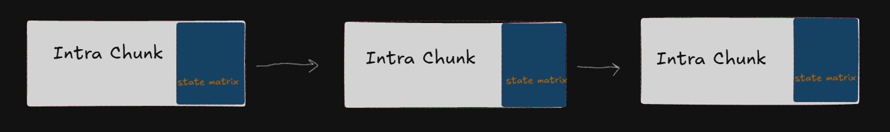
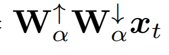
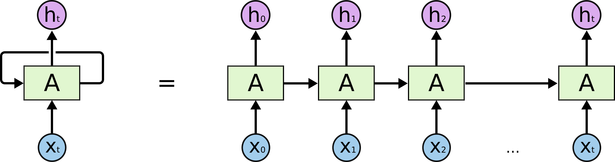
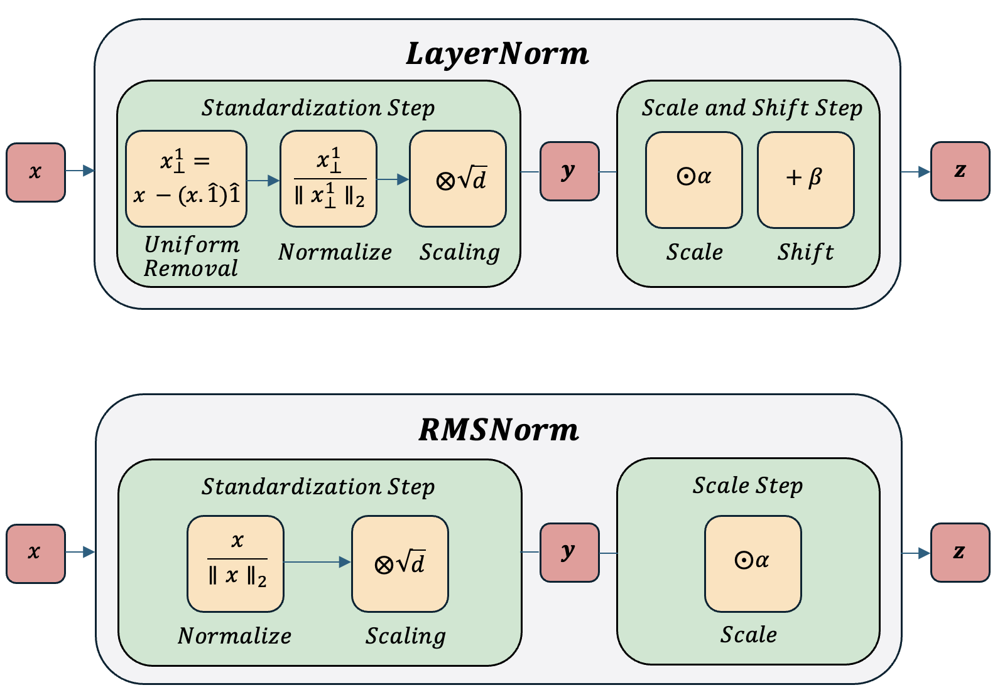
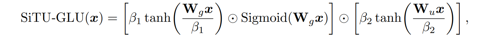
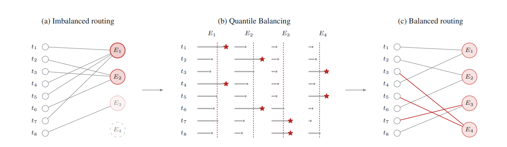

## Understanding Kimi K3's Architecture

Kimi K3 has 2.8T parameters,MoE 104B params.It has native vision capabilities , 1 million context window. Built on Kimi Delta Attention , attention residuals , Stable LatentMoE, MLA(multi head latent attention) which i will discuss in this blog.I will just explain the "architecture" of the model,i will not touch pre training, post training or vision capabilities. Just NLP and basics.

As you can see above,there is a new attention type called "Kimi Delta Attention" (KDA). So lets jump on this side.

## Hybrid Attention

Normal (softmax) attention has a problem. It is O(n^2). Because it compares every token with another,which is not efficient and not scalable So,they offer a new architecture.
## Linear Attention
Instead of comparing all pairs,linear attention compresses tokens into 1 state. In self attention we dot product Q and K then pass them by softmax then dot product with V. It causes KV cache because we have 2 long matricies. In linear attention we dot product K and V then pass them to STATE then dot product with Q, which has compressed memory but less info. A trade off for sure.Decay controlling how much old information survives

So they use a ratio "3:1" ; 3 KDA layer , 1 gated MLA layer. KDA is fast , gated MLA has very cost but it is full capacity global attention.
## Kimi Delta Attention (KDA)
  KDA is Kimi K3's specific implementation of linear attention.We'll go through below.A channel-wise forget gate and a few extra 
  building blocks((ShortConv, Swish, L2Norm))

So lets take a look at to how does memory updates?

St stands for recurrent state.
-Forget gate (it reminds me of an LSTMs forget gate...)
Each step , considering input then produce a value which is between 0 and 1. for every channel
-New Weak Value Produced β_t × S_{t-1}
-New Information  k_t × v_t^T
-Sum all of them weak value + new information is the new St
Finally dot product with Q and get an output. Which is o with tilda (~).

You may ask "how did we produce these values?" W,β,q_t etc.
Here is the diagram

## Linear Projection

It is not something new. We already have it at "normal" attention.It is basicallty ,process of transferring data from a high-dimensional space to a lower-dimensional subspace using mathematical transformations. I considered as "low-rank".
You can compare this to shining a light on a 3D object and projecting its shadow onto a wall, essentially reducing it to 2D. Here, we use this to generate q, k, and v. 

## ShortConv
Basic convolution traverses all channels and consumes extra memory. To solve this, we apply a simpler 1D convolution, which ensures it doesn't miss context between nearby channels. This is because while it relies on the linear attention state vector, it can miss local relationships. It does not require a memory that much.

## Swish Activation 
We need an activation function for non linearity. So instead of using gelu. They 

Swish= sigmoid times input . It is not strict for negative values like ReLU.

## L2Norm 
There is to L2 form. One is L2 Norm other one is L2 regularization.They might confuse them with each other, so I want to clarify this part:
  The L2 norm is a mathematical formula that measures the length or magnitude of a vector, while L2 regularization (or Ridge regression,tikhonov regularization) is a machine learning technique that adds the squared value of that norm to a model's loss function to prevent overfitting
We apply L2Norm to q and k . Not v . because v has a lots of info itself, we do not want  to loss this informations so we do not normalize this vector. It is valuable for us . It fixes the dimensions of Q and K. 

## Chunkwise Parallel Form

Now we understand the architecture.The texts above are about "math" but now, it is about engineering optimizations.
It is a hybrid solution for parallel computation/process. Hybrid stands for: parallel + sequential.
When updating KDA's recurrent state as you remember, it have to be sequential.Token to token.But GPUs cannot utilize when doing sequential process. They want to work parallel.

What is chunking? It basically splits big number of tokens to less number of tokens. Like, 4096 to 64,64 ... or 128,128... etc.
Split seqeunce into "chunks". Tokens do not wait each other and computes independently. 
Intra-Chunking:
- Each block pretends like self attention computation.All parallel. Softmax attention.
Inter-Chunking
- Informations have to send to other block.Information have to flow block by block.Linear transfer.

Instead of sequential computation of 1000 token , they offer this chunkwise method.

## Gated MLA
MLA stands for multi head latent attention.
Compressing each tokens key & value --> Latent vector
Then expand it when it necessary.
In normal multi head attention, store each key and value in 2 different vector and it causes KV cache.

- NoPE(No positional encoding)
Do not add RoPE because position informations are already satisfies in KDA layers (decay mechanism).

Adding gate to MLAs output. That is why we call it gated mla. It is basically like , low rank.

Let's compare
KDA->LOCAL.FAST.BAD AT LONG TERM CONNECTIONS
MLA->GLOBAL.O(n^2). GOOD AT LONG TERM. 
3 KDA 1 MLA result is a ampiric result. "3:1"

## Attention Residuals
There is a problem with residuals.Let's think RNNs. They add all residuals cumulatively.

Each residual is "valueable" they are basically have same valueable. But AttnRes solves this unfairity problem.Each layer can view all layers before and select them bu value. Each layer has "pseudo-query" and it represents "this layer looking for what in past layers?" Then compare with past layers key, sum values.It is like token based attention but reflect to layer based.
There is a trade off. Each layer is not performing the task it is supposed to. They have extra "pseudo-query" + attention with all past layer outputs.So they offer block attention residuals.
- Pseudo query does not change by token. It's learnable vector. Constant. Freezes after training.

## Stable LatentMoE

Kimi K3 has 986 routed experts with 16 active experts. Increasing expert number causes a decrease in GPU performance.So latent moe solves it . Shared experts work on full space but routed experts work on compressed "latent space".The token is compressed into a smaller latent dimension (using W↓) before being sent to the routed experts; the expert processes it in this reduced dimension, and it is then expanded back to its original size (using W↑). This follows the same latent-space logic found in MLA, applied here to MoE.
It cause 2 new problem. Exploding activations ,load balancing.
- In the routed path, data passes through a series of consecutive matrix multiplications (down-projection → expert → up-projection); at the 2.8T scale, this chain leads to the uncontrolled growth of values.
- It becomes difficult to distribute tokens evenly among the 896 experts—some become overloaded, while others are never selected ("die"). So they offer RMSNorm,SiTU-GLU

  # RMSNorm
  The sum of the routed experts (u) is normalized before entering W↑. This corrects scale inconsistency and prevents explosion.
  
  # SiTU-GLU
  Instead of standard SwiGLU (gate × value, where both can grow without bound), they constrain both branches using a scaled tanh. It behaves like SwiGLU.
    
  # Quantile Balancing 
  If we let router to select experts by itself. It can select same experts all the time. I considered it like mode collapse in GANs. They add bias.The bias of the overloaded expert is lowered (to make it less attractive), while the bias of the underloaded one is raised.
  
