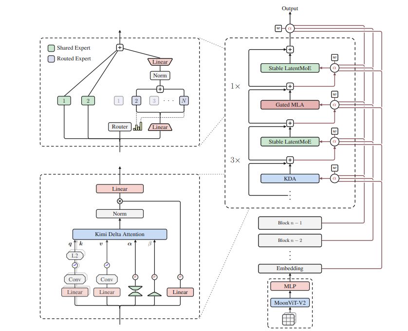
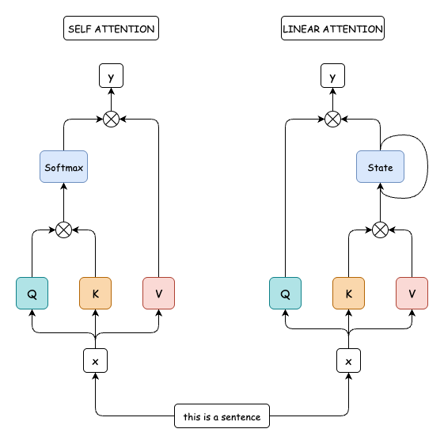
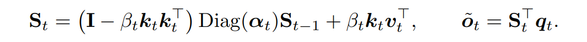
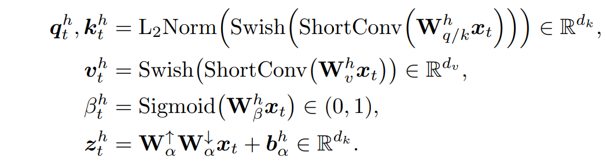
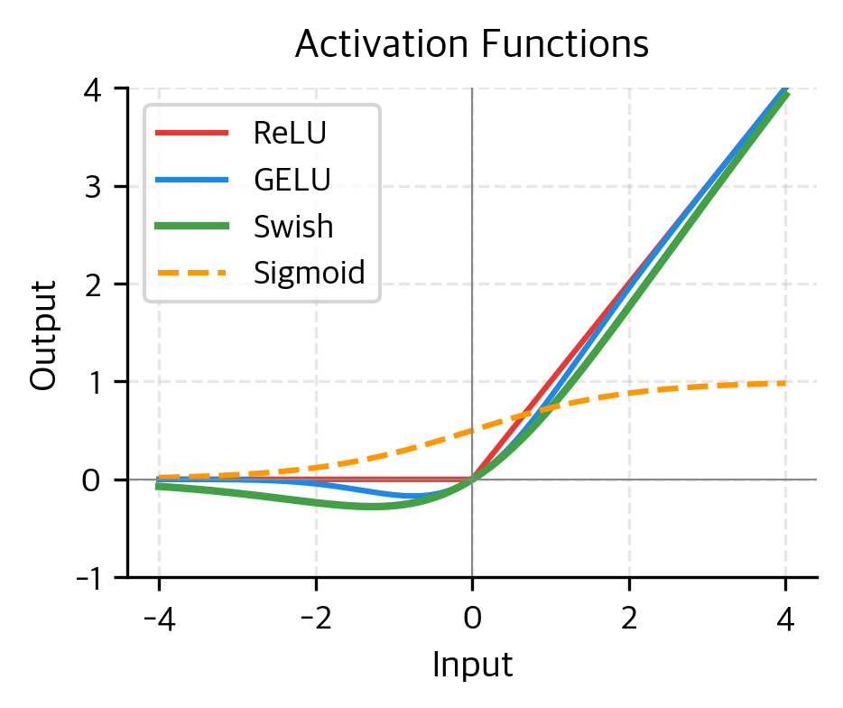

## Understanding Kimi K3's Architecture

Kimi K3 has 2.8T parameters,MoE 104B params.It has native vision capabilities , 1 million context window. Built on Kimi Delta Attention , attention residuals , Stable LatentMoE, MLA(multi head latent attention) which i will discuss in this blog.I will just explain the "architecture" of the model,i will not touch pre training, post training or vision capabilities. Just NLP and basics.

As you can see above,there is a new attention type called "Kimi Delta Attention" (KDA). So lets jump on this side.

## Hybrid Attention

Normal (softmax) attention has a problem. It is O(n^2). Because it compares every token with another,which is not efficient and not scalable So,they offer a new architecture.
## Linear Attention
Instead of comparing all pairs,linear attention compresses tokens into 1 state. In self attention we dot product Q and K then pass them by softmax then dot product with V. It causes KV cache because we have 2 long matricies. In linear attention we dot product K and V then pass them to STATE then dot product with Q, which has compressed memory but less info. A trade off for sure.Decay controlling how much old information survives

So they use a ratio "3:1" ; 3 KDA layer , 1 gated MLA layer. KDA is fast , gated MLA has very cost but it is full capacity global attention.
## Kimi Delta Attention (KDA)
  KDA is Kimi K3's specific implementation of linear attention.We'll go through below.A channel-wise forget gate and a few extra 
  building blocks((ShortConv, Swish, L2Norm))

So lets take a look at to how does memory updates?

St stands for recurrent state.
-Forget gate (it reminds me of an LSTMs forget gate...)
Each step , considering input then produce a value which is between 0 and 1. for every channel
-New Weak Value Produced β_t × S_{t-1}
-New Information  k_t × v_t^T
-Sum all of them weak value + new information is the new St
Finally dot product with Q and get an output. Which is o with tilda (~).

You may ask "how did we produce these values?" W,β,q_t etc.
Here is the diagram

# Linear Projection

It is not something new. We already have it at "normal" attention.It is basicallty ,process of transferring data from a high-dimensional space to a lower-dimensional subspace using mathematical transformations. I considered as "low-rank".
You can compare this to shining a light on a 3D object and projecting its shadow onto a wall, essentially reducing it to 2D. Here, we use this to generate q, k, and v. 

## ShortConv
Basic convolution traverses all channels and consumes extra memory. To solve this, we apply a simpler 1D convolution, which ensures it doesn't miss context between nearby channels. This is because while it relies on the linear attention state vector, it can miss local relationships. It does not require a memory that much.

## Swish Activation 
We need an activation function for non linearity. So instead of using gelu. They 

Swish= sigmoid times input . It is not strict for negative values like ReLU.

## L2Norm 
There is to L2 form. One is L2 Norm other one is L2 regularization.They might confuse them with each other, so I want to clarify this part:
  The L2 norm is a mathematical formula that measures the length or magnitude of a vector, while L2 regularization (or Ridge regression,tikhonov regularization) is a machine learning technique that adds the squared value of that norm to a model's loss function to prevent overfitting
We apply L2Norm to q and k . Not v . because v has a lots of info itself, we do not want  to loss this informations so we do not normalize this vector. It is valuable for us . It fixes the dimensions of Q and K. 
